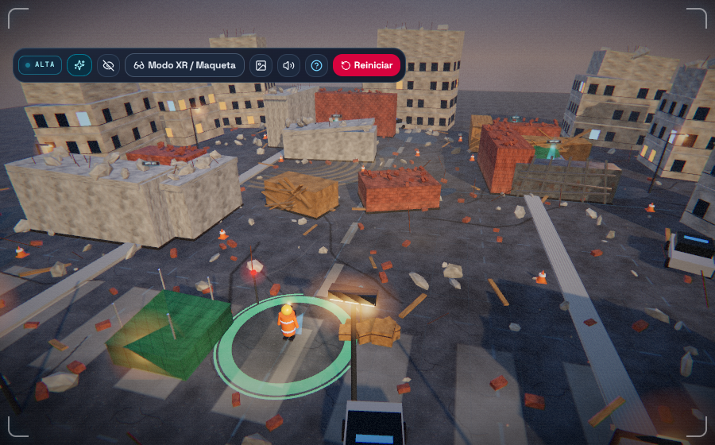

# WTS — Juego Interactivo de Realidad Mixta y Rescate Sísmico

Prototipo interactivo 3D y de Realidad Mixta (**WebXR `immersive-ar`**) inspirado en el proyecto **WTS (Sistema Wearable de Emergencia)**: un arnés pectoral autónomo con sensores biométricos e inerciales, procesamiento local **TinyML**, **capa térmica flexible con control PWM** y radiobaliza **RF Sub-GHz de 433 MHz** (sin necesidad de internet, red celular ni infraestructura eléctrica externa), junto con el **Receptor del Rescatista**.



> **Nueva edición gráfica:** render HDR con bloom, texturas PBR procedurales, ciudad derrumbada detallada, iluminación cinematográfica y HUD rediseñado. [Ver todos los detalles abajo](#edición-gráfica-mejorada-ultra-hd).


---

## Características Principales

### 1. Ciclo Completo de Emergencia y Dos Modos Jugables + Inspector 3D
- **Modo Persona con el Chaleco (`WTS 014`)**:
  - Experimenta la emergencia desde un hueco estructural tras el terremoto.
  - Desplázate ligeramente, permanece inmóvil para observar el contador inercial o produce **secuencias de golpes rítmicos** (con `Espacio`, botón en pantalla o haciendo clic directamente sobre el chaleco 3D) para activar la alerta **«Posible SOS»** y forzar una transmisión prioritaria en **433 MHz**.
- **Modo Rescatista (3D en navegador y Realidad Mixta WebXR)**:
  - Explora la zona urbana dañada con el **Receptor de 433 MHz** en mano.
  - Alterna entre las 4 balizas (`WTS 014`, `WTS 007`, `WTS 021`, `WTS 032`), interpreta la frescura de los datos, gestiona prioridades y batería, y rastrea mediante **barras RSSI y guía acústica** hasta localizar y rescatar a cada superviviente antes de que termine el tiempo.
- **Inspector Técnico 3D (360°)**:
  - Inspecciona el **Arnés Pectoral** (vista frontal y dorsal) y el **Receptor del Rescatista**, pulsa sus botones físicos y selecciona cada módulo para consultar su rol técnico y compararlo con el boceto conceptual original.

### 2. Funcionamiento Simulado Fiel al Sistema WTS
1. **Signos vitales y movimiento en tiempo real**: simulación dinámica de **Pulso (lpm)**, **SpO₂ (%)**, **Temperatura cutánea (°C)** y acelerometría **IMU (`g` y segundos de inmovilidad)** modulados por frío ambiental, actividad y eventos.
2. **MCU + TinyML local y prioridades educativas inspiradas en START**: clasificación local con indicadores luminosos **`VERDE`**, **`AMARILLO`**, **`ROJO`** y **`NEGRO`**.
   > *Nota educativa explícita*: la prioridad mostrada constituye una simulación orientativa inspirada en triaje START para organizar la búsqueda; **no representa una evaluación médica real ni deduce fallecimiento** por ausencia de señal o pérdida de contacto de sensor.
3. **Detección de golpes rítmicos («Posible SOS»)**: analizador de cadencia en el IMU dorsal que distingue golpes rítmicos intencionales (3+ impactos en ventana rítmica) frente a movimientos ordinarios.
4. **Propagación RF Sub-GHz en 433 MHz realista (sin exigir LoRa)**: cálculo de pérdidas por trayecto, orientación corporal, desvanecimiento multicamino (*multipath*) y **atenuación específica por materiales** (madera, ladrillo, hormigón armado y vigas de acero), generando zonas de sombra donde la señal no atraviesa escombros densos.
5. **Frescura de telemetría en el Receptor**: identificación de baliza, minigráficas en vivo, nivel de batería, estado SOS, RSSI y avisos claros de **`DATO DESACTUALIZADO`** (> 4.5 s) o **`SIN COMUNICACIÓN RF`** (> 10 s, congelando la última lectura válida recibida).
6. **Guía de búsqueda no-GPS**: navegación guiada únicamente por barras RSSI (0–5) y pulsos acústicos Web Audio cuya frecuencia y tono varían al desplazarse y rodear obstáculos, sin flechas GPS ni distancias exactas.
7. **Hipotermia simulada y Capa Térmica Flexible PWM**: animación del circuito calefactor serpentino encendido por pulsos (**PWM**), estabilización y recuperación gradual de la temperatura, incremento medible de consumo (`mW`) y recorte automático a modo ahorro cuando la batería es baja.

### 3. Realidad Mixta (WebXR) y Adaptabilidad PC / Móvil
- **Con soporte WebXR (`immersive-ar` + `hit-test`)**: coloca la maqueta del terremoto sobre una mesa o suelo real mediante cámara AR y desplázate físicamente alrededor de los edificios para buscar señales de 433 MHz.
- **Sin cámara o sin WebXR**: versión 3D completa directamente en navegador con vista en primera persona (receptor 3D en mano) y **Vista Maqueta Espacial**, adaptable a computador (teclado + ratón) y móvil (cruceta táctil y paneles plegables).

---

## Edición Gráfica Mejorada (Ultra HD)

Esta versión conserva **toda la simulación educativa original** (TinyML, PWM térmico, propagación RF 433 MHz, RSSI, WebXR y pruebas unitarias) pero renueva por completo el apartado visual:

### Render cinematográfico
- **HDR + ACES Filmic tone mapping**, espacio de color sRGB, exposición calibrada y **MSAA 4x** en el buffer de postprocesado.
- **Bloom (UnrealBloomPass)** selectivo sobre leds, balizas, faros, fuego de emergencia y el sol.
- **Grado de color propio**: viñeta animada, grano fílmico sutil y aberración cromática en los bordes.
- **Iluminación física de tres puntos**: sol cálido con **sombras suaves PCF** (mapa 2048), luz hemisférica, rim fría, rebote cálido y **reflejos image-based (PMREM)** sobre metal, cristal y charcos.
- **Cielo atmosférico procedural** con shader propio: degradado cenit/horizonte, disco solar, scattering, neblina de polvo y **nubes que se desplazan** en tiempo real.

### Mundo 3D reconstruido
- **Texturas PBR generadas por código** (color + bump + rugosidad) para asfalto, hormigón, ladrillo, madera, acero, óxido, fachadas y lona: grietas, manchas, áridos vistos, remaches y vetas.
- **9 edificios dañados** con ventanas instanciadas (algunas iluminadas), forjados vistos, hierros de armado, plantas superiores derrumbadas y escombros en cubierta.
- **Obstáculos RF detallados** según su material real: losas fracturadas, ladrillos sueltos, vigas de acero retorcidas, andamiaje de madera y ferralla expuesta.
- **Campo de escombros** con más de 450 piezas instanciadas (hormigón, ladrillos, varillas, tablones), **charcos reflectantes**, pintura vial desgastada, aceras, conos, farolas, vehículos abandonados y cinta de señalización.
- **Base de mando** con tienda textil, mesa holográfica, cajas, mástil de iluminación, focos y **balizas rojas/azules intermitentes**.
- **Atmósfera volumétrica simulada**: 900 motas de polvo, 170 brasas ascendentes, columnas de humo, neblina baja y haces de luz aditivos en cada baliza.
- **Marcadores holográficos 433 MHz** (columna de luz, halo, anillo giratorio y etiqueta) visibles en Vista Maqueta o al activar los Rayos RF educativos. En primera persona se ocultan para no revelar posiciones y preservar la navegación por RSSI.
- **Modelos de dispositivo mejorados**: maniquí con cabeza, arnés con mejores materiales, rescatista con casco, visor, bandas reflectantes, mochila de radio y lámpara frontal; pedestal de inspector metálico con iluminación de estudio dedicada.

### Interfaz HUD
- Tipografías **Space Grotesk** y **JetBrains Mono** incluidas localmente (sin depender de internet).
- Paneles de cristal con bordes luminosos, viñeta, scanlines, esquinas de HUD, animaciones y scrollbars temáticos.
- **Tira de telemetría RF en vivo** con barras de señal, RSSI y rumbo.
- **Selector de calidad gráfica** (Ultra / Alta / Eco): ajusta sombras, bloom, grano, DPR y densidad de partículas. En móviles se activa automáticamente el preset equilibrado.
- **Modo cine** (botón del ojo): oculta toda la interfaz para disfrutar la escena 3D a pantalla completa.

---

## Requisitos e Instrucciones de Ejecución

### Requisitos previos
- **Node.js** `>= 18` (probado en Node 22) y **npm** `>= 9`.

### 1. Instalar dependencias
```bash
npm install
```

### 2. Ejecutar en modo desarrollo
```bash
npm run dev
```
Abre en tu navegador la URL mostrada en consola (por defecto `http://localhost:5173`).

> **Nota para Realidad Mixta (WebXR AR) en móvil**: los navegadores móviles (p. ej. Chrome en Android compatible con ARCore) requieren contexto seguro (`https://` o reenvío de puertos `localhost` mediante `chrome://inspect`) para habilitar `navigator.xr.requestSession('immersive-ar')`. Si no está disponible, el juego ofrece automáticamente el modo 3D completo en navegador.

### 3. Ejecutar pruebas automatizadas del motor de simulación
```bash
npm test
```

### 4. Compilar para producción
```bash
npm run build
npm run preview
```

### 5. Despliegue automático 24/7 en GitHub Pages
El repositorio incluye el flujo `.github/workflows/deploy.yml` para compilar y publicar automáticamente el juego en **GitHub Pages** cada vez que se actualiza la rama `main`:
1. En GitHub, ve a **Settings → Pages → Build and deployment**.
2. En **Source**, selecciona **GitHub Actions**.
3. Al fusionar cambios en `main` (o ejecutar el workflow desde la pestaña **Actions**), el sitio quedará publicado permanentemente en:
   `https://batrax24.github.io/Juego-interactivo-proyecto-WTS/`

---

## Controles Rápidos

| Acción | Computador (Teclado y Ratón) | Móvil / Pantalla Táctil |
| --- | --- | --- |
| Moverse | `W`, `A`, `S`, `D` o Flechas `↑` `↓` | Cruceta táctil en esquina inferior izquierda |
| Mirar / Orbitar cámara 3D | Arrastrar con el ratón (`clic + mover`) / Rueda para zoom | Arrastrar sobre la escena 3D + botones `↺` / `↻` |
| Golpes rítmicos SOS (Modo Chaleco) | Tecla `Espacio` / `T`, botón **GOLPEAR ARNÉS SOS** o clic sobre el chaleco 3D | Botón táctil **GOLPE SOS** o tocar el chaleco 3D |
| Cambiar de baliza en el Receptor | Botones `◀` / `▶`, pestañas `#014..#032` o teclas `Z` / `X` | Tocar `◀` / `▶` o pestañas superiores del receptor |
| Confirmar localización / Rescatar | Botón **`OK`** en el receptor o teclas `E` / `Enter` al estar cerca (< 4.6 m) | Botón **`OK`** o botón emergente **¡RESCATAR PERSONA!** |
| Activar eventos del escenario | **Panel de Situaciones y Eventos WTS** (Frío, Inmovilidad, Golpes SOS, Señal débil, Batería baja, Sin sensor) | Pestaña **Situaciones** |
| Cambiar calidad gráfica (Ultra / Alta / Eco) | Botón **✦ Ultra / Alta / Eco** en la barra superior | Ícono de chispas en la barra superior |
| Ocultar / mostrar interfaz (modo cine) | Botón del **ojo** en la barra superior | Botón del **ojo** |

---

## Estructura del Proyecto

- `src/types/wts.ts` — Modelos de datos de sensores, tramas RF 433 MHz, enlaces y estados de misión.
- `src/simulation/` — Motor físico y lógico desacoplado:
  - `sosDetector.ts` — Reconocimiento de cadencia rítmica de golpes en el IMU.
  - `tinymlProcessor.ts` — Clasificación local de prioridades educativas START y lazo de control térmico PWM.
  - `rfPropagation.ts` — Propagación Sub-GHz en 433 MHz con intersección geométrica de obstáculos y materiales.
  - `wtsEngine.ts` — Coordinador general de la emergencia, balizas, baterías y registro explicativo en vivo.
- `src/three/` — Modelos 3D procedurales fieles al boceto (`vestModel.ts`, `receiverModel.ts`), gestor de escena 3D + WebXR (`disasterScene.ts`) y el nuevo sistema visual:
  - `visualAssets.ts` — Texturas PBR procedurales, cielo shader, entorno PMREM, sprites y shader de grado cinematográfico.
  - `scenery.ts` — Ciudad derrumbada, escombros, base de mando, mobiliario urbano, atmósfera de partículas y marcadores de baliza.
- `src/audio/soundEngine.ts` — Sintetizador procedural Web Audio API sin dependencias de archivos externos.
- `src/components/` — Interfaz reactiva en español (Receptor interactivo, Telemetría del Chaleco, Panel de Situaciones, Inspector 3D, Controles Táctiles y Tutorial).
